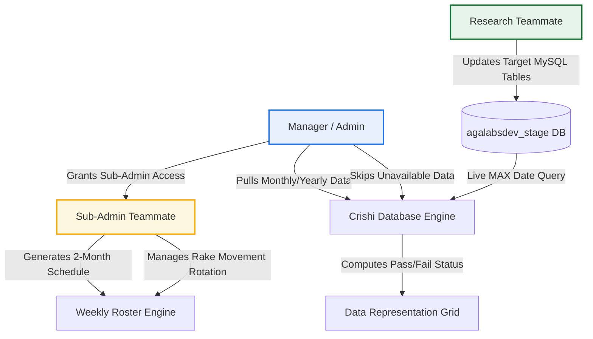

# Project Goals & Strategic Vision: Advanced MIS Redesign

> **Document Version:** 2.0  
> **Status:** Approved Architecture Blueprint  
> **Scope:** Full System Redesign — Verification Paradigm Shift, Menu Consolidation, Crishi DB & Report Automation

---

## 1. Executive Summary

The **Advanced MIS** system is undergoing a comprehensive architectural overhaul. In the legacy workflow, team members manually logged into the MIS interface and clicked buttons or submitted forms to declare that their daily research, data uploads, or report tasks were complete. This model suffered from significant vulnerabilities:
1. **Self-Reported Completion Without Proof:** Users could mark tasks as "Done" without actually updating the underlying agricultural databases.
2. **Double Work & Inefficiency:** Analysts had to upload data to the central database (`agalabsdev_stage`) and then separately log into the MIS to record that they had done so.
3. **Menu Clutter & Feature Bloat:** The legacy application accumulated auxiliary modules (Kanban boards, ad-hoc chat channels) that diverted attention from core operational goals.

### The New Paradigm: Automated Database Table Verification
In the redesigned MIS:
> **"No user will manually update task completion in the MIS UI."**  
> Instead, task completion is **automatically proven by detecting real data updates in the target database (`agalabsdev_stage`)**.

When an analyst inserts or updates data in their designated MySQL tables within `agalabsdev_stage`, the MIS automatically queries the table's latest timestamp (`MAX(date_column)`), evaluates timeliness against strict cadence rules, and updates the task status to **Pass (Green)** or **Fail (Red)** without requiring any self-reporting by the user.

---

## 2. Core Business Goals

| Goal ID | Strategic Objective | Metric of Success |
| :--- | :--- | :--- |
| **G-01** | **Eliminate Manual Self-Reporting** | 100% of data update tasks verified directly from `agalabsdev_stage` table timestamps. |
| **G-02** | **Simplify Navigation & User Focus** | Reduce navigation from 4 complex modules down to **2 Core Modules**: **Crishi Database** and **Report**. |
| **G-03** | **Automate Report Collection via Email** | Ingest all market daily/weekly PDF reports directly from Gmail with zero manual upload needed. |
| **G-04** | **Intelligent 3-in-1 Report Inspection** | Provide instant 1-click inspection combining Email Headers/Body, Embedded PDF Viewer, and AI-Powered Report Analysis. |
| **G-05** | **Equitable 2-Month Roster Engine** | Automate weekly roster generation for 8–9 weeks with zero consecutive repeating tasks, including the critical **Rake Movement** logistics task. |
| **G-06** | **Sub-Admin Delegation for Teammates** | Empower designated teammates with "Sub-Admin" privileges strictly scoped to roster scheduling. |
| **G-07** | **Variable Cadence Governance (Pull vs Auto)** | Auto-verify Daily/Weekly tasks with Admin Skip; require explicit Manager "Pull" confirmation for Monthly/Yearly/Occasional tasks before late flags trigger. |

---

## 3. Scope & Structural Reorganization

### 3.1 What is Kept & Promoted (The 2 Core Modules)

```
================================================================================
                    REDESIGNED ADVANCED MIS NAVIGATION
================================================================================
          ┌────────────────────────────────────────────────────────┐
          │                  ADVANCED MIS PORTAL                   │
          └───────────┬────────────────────────────────┬───────────┘
                      │                                │
                      ▼                                ▼
       ┌──────────────────────────────┐ ┌──────────────────────────────┐
       │     1. CRISHI DATABASE       │ │          2. REPORT           │
       ├──────────────────────────────┤ ├──────────────────────────────┤
       │ • Live DB Update Tracking    │ │ • Automated Gmail Ingestion  │
       │ • agalabsdev_stage Auditing  │ │ • Email Preview Panel        │
       │ • Pass (Green) / Fail (Red)  │ │ • Interactive PDF Viewer     │
       │ • Manager "Pull" Workflow    │ │ • AI Report Analysis         │
       │ • Admin "Skip" Override      │ │ • Commodity & Date Filters   │
       │ • 2-Month Roster Generation  │ │ • Historical Archive         │
       │ • Rake Movement Rotation     │ └──────────────────────────────┘
       │ • Sub-Admin Access Control   │
       └──────────────────────────────┘
```

### 3.2 What is Hidden / Decommissioned

- **Kanban Board:** Hidden from the top navigation, sidebar, and dashboard. Sprints, ad-hoc cards, and drag-and-drop story point workflows are removed to eliminate distractions.
- **Team Chat:** Hidden from the UI. Communication will flow through dedicated operational alerts and existing organizational channels (e.g., WhatsApp / Slack / Email), removing in-app chat clutter.
- **Old "Tasks" Self-Reporting Form:** Replaced completely by the automated Crishi Database Live Table Status grid.
- **Old Manual PDF Upload Form:** Replaced completely by the automated Gmail ingestion pipeline.

---

## 4. Key Personas & Roles



1. **Manager / Admin:**
   - Full oversight across all commodities and users.
   - Authorizes "Sub-Admin" access to specific teammates for roster management.
   - Controls the **Manager "Pull"** action for Monthly, Yearly, and Occasional tasks when source data is verified available.
   - Executes **Admin "Skip"** overrides when external sources (APIs, mandis, government websites) fail or have holidays.
2. **Sub-Admin (Roster Only):**
   - A research teammate granted elevated privileges strictly scoped to the Roster engine.
   - Generates the 2-month unique non-repeating roster.
   - Rotates assignments, including the Rake Movement duty, and manages teammate leave swaps.
   - Does *not* have access to managerial system settings, user credential deletion, or audit purge.
3. **Teammate / Commodity Analyst:**
   - Focuses entirely on data extraction and database population in `agalabsdev_stage`.
   - Views their personal task grid: `User | Commodity | Raw Table | Final Name | Frequency | Last Updated | Due Date | Status | Remark | Source`.
   - Adds explanatory remarks if an update is delayed or anomalous.

---

## 5. Architectural Alignment with Workspace Context

- **Target Research Database:** `agalabsdev_stage` hosted locally or on the designated MySQL server (Port 3306, user `root`, connection `Nishant`).
- **Snapshot Baseline:** The `latest_two_dates_agalabsdev_stage` folder contains 132 real exported table CSVs demonstrating the exact table names (`ipga_*`, `pyexcel_*`, `pystage_*`, `sopa_*`), date columns (`Date`, `CreatedDate`, `published_at`, `MarketYearDate`), and multi-commodity scope.
- **ERP Metadata Database:** `advance_erp` will store system configurations, roster allocations, pull/skip logs, user permissions, and email report metadata, maintaining a clean separation of concerns.

---

## 6. Document Suite Directory

This document is Part 1 of the official redesign documentation:
- [01_REDESIGN_GOALS_AND_VISION.md](file:///d:/D%20Disk%20Data%20Backup/Nishant_800mb/Nishant/Aniygravity/Advance%20ERP/docs/01_REDESIGN_GOALS_AND_VISION.md) — Strategic Vision & Paradigm Shift *(This Document)*
- [02_REQUIREMENTS_SPECIFICATION.md](file:///d:/D%20Disk%20Data%20Backup/Nishant_800mb/Nishant/Aniygravity/Advance%20ERP/docs/02_REQUIREMENTS_SPECIFICATION.md) — Detailed Functional & Non-Functional Requirements
- [03_CRISHI_DATABASE_MODULE_SPEC.md](file:///d:/D%20Disk%20Data%20Backup/Nishant_800mb/Nishant/Aniygravity/Advance%20ERP/docs/03_CRISHI_DATABASE_MODULE_SPEC.md) — Crishi DB, 2-Month Roster, Rake Movement & Frequency Rules
- [04_REPORT_MODULE_AND_GMAIL_INTEGRATION.md](file:///d:/D%20Disk%20Data%20Backup/Nishant_800mb/Nishant/Aniygravity/Advance%20ERP/docs/04_REPORT_MODULE_AND_GMAIL_INTEGRATION.md) — Automated Gmail Ingestion & 3-in-1 Report Preview Modal
- [05_TASK_TO_DATABASE_MAPPING_MATRIX.md](file:///d:/D%20Disk%20Data%20Backup/Nishant_800mb/Nishant/Aniygravity/Advance%20ERP/docs/05_TASK_TO_DATABASE_MAPPING_MATRIX.md) — Master Table Matrix (User > Commodity > Raw Table > Final Name > Frequency > Source)
- [06_SYSTEM_ARCHITECTURE_AND_TECHNICAL_DESIGN.md](file:///d:/D%20Disk%20Data%20Backup/Nishant_800mb/Nishant/Aniygravity/Advance%20ERP/docs/06_SYSTEM_ARCHITECTURE_AND_TECHNICAL_DESIGN.md) — System Architecture, DDL, Daemon & API Specs
- [07_IMPLEMENTATION_ROADMAP_AND_MIGRATION_PLAN.md](file:///d:/D%20Disk%20Data%20Backup/Nishant_800mb/Nishant/Aniygravity/Advance%20ERP/docs/07_IMPLEMENTATION_ROADMAP_AND_MIGRATION_PLAN.md) — Phased Rollout & Migration Strategy
