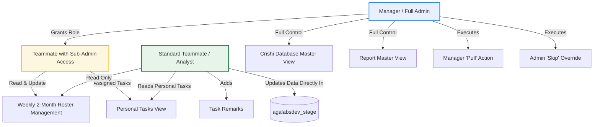

# Detailed Requirements Specification: Advanced MIS Redesign

> **Document Version:** 2.0  
> **Status:** Formal Specification  
> **Target System:** Advanced MIS Redesign (Python / Flask / MySQL / Vanilla JS)

---

## 1. System Context & Overview

The redesigned Advanced MIS application transitions from a manual tracking spreadsheet replacement into an **Automated Operational Data Surveillance and Intelligence System**. It connects directly to the core research database (`agalabsdev_stage`) to verify data updates in real time, manages team rotations through an equitable roster engine, and automates market research report collection and analysis directly from incoming emails.

---

## 2. User Roles & Access Control Specification (RBAC)

The system supports a hierarchical, role-based access model with a specialized granular delegation:



| Role | Module Visibility | Permitted Actions |
| :--- | :--- | :--- |
| **Manager / Admin** | • Crishi Database (All Commodities)<br>• Report (All Commodities)<br>• Settings & User Management | • View and filter all users, commodities, and tables.<br>• Execute **Manager "Pull"** on Monthly/Yearly/Occasional tasks.<br>• Execute **Admin "Skip"** on Daily/Weekly tasks with audit reasoning.<br>• Grant / Revoke **"Sub-Admin"** access for the roster to teammates.<br>• Edit table Source URLs.<br>• View all email reports, PDF attachments, and AI summaries. |
| **Sub-Admin (Roster Only)** | • Crishi Database (Assigned Commodities + Full Roster View)<br>• Report (Assigned Commodities) | • **Full management of Weekly Roster:** generate 2-month schedules, assign/reassign duties (including Rake Movement), handle duty swaps.<br>• *Restricted:* Cannot execute Manager Pulls or Admin Skips outside assigned scope; cannot modify global user roles. |
| **Teammate / Analyst** | • Crishi Database (Assigned Commodity scope)<br>• Report (Assigned Commodity scope) | • View status of assigned tables (`Pass` vs `Fail`).<br>• Add / Edit explanatory **Remarks** on delayed or flagged tables.<br>• View the published Weekly Roster (Read-Only).<br>• View received email reports and PDF previews for their commodities. |

---

## 3. Functional Requirements (FR)

### 3.1 Navigation & Workspace Consolidation

- **[FR-01] Module Consolidation:** The top navigation and main sidebar must display only two primary business modules:
  1. **Crishi Database**
  2. **Report**
- **[FR-02] Hide Legacy Modules:** The "Kanban Board" and "Team Chat" navigation items, routes, and UI components must be hidden / deactivated. The legacy manual task creation and manual PDF upload forms must be decommissioned.

---

### 3.2 Crishi Database — Automated Verification & Data Representation

- **[FR-03] Direct Database Table Verification:** 
  The system must not rely on user button clicks to verify task completion. The MIS backend will run periodic and on-demand surveillance queries against `agalabsdev_stage` to find the latest recorded date:
  ```sql
  SELECT MAX(`{date_column}`) AS latest_date FROM `agalabsdev_stage`.`{raw_table_name}`;
  ```
- **[FR-04] Standard Data Representation Grid:** 
  The Crishi Database UI must present a comprehensive, real-time monitoring grid containing the exact 10 columns specified:
  1. **User:** Name of the assigned researcher (e.g., Nishant, Nitesh, Deep, Manish, Priyanshi, Poorvi).
  2. **Commodity:** Business commodity category (e.g., Bengal Gram, Maize, Soybeans, Sugar, Rice, Weather).
  3. **Raw Table Name:** Physical table name in `agalabsdev_stage` (e.g., `pyexcel_rakemovement`, `ipga_imported_market_prices`).
  4. **Final Name:** Clean, descriptive human-readable name (e.g., "Daily Rake Movement", "Imported Market Prices").
  5. **Frequency:** Task cadence (`Daily`, `Weekly`, `Monthly`, `Yearly`, `Occasionally`).
  6. **Last Updated Date:** Formatted date extracted from the table's `MAX(date_column)`.
  7. **When It Should Be Updated:** Computed target due date based on schedule, frequency, and cutoff time.
  8. **Status:**
     - **Pass (Green):** When `last_updated_date >= expected_target_date` OR task has been approved as `Admin Skipped`.
     - **Fail (Red):** When `last_updated_date < expected_target_date` AND cutoff time has elapsed without a data update.
  9. **Remark:** Free-text remark field populated by the user or manager (e.g., "Source portal down; scheduled update for tomorrow").
  10. **Source:** Master data origin (e.g., `NCDEX`, `Agmarknet`, `IPGA Portal`, `IMD`, `USDA WASDE`). Configured once, editable by managers or authorized users when source changes.

- **[FR-05] Grid Filtering & Search:**
  Users must be able to filter the grid by:
  - Commodity dropdown
  - User / Assignee dropdown
  - Frequency dropdown (Daily, Weekly, Monthly, Yearly, Occasionally)
  - Status toggle (`All`, `Fail (Red) Only`, `Pass (Green) Only`)
  - Free-text search matching Table Name, Final Name, or Source.

---

### 3.3 Frequency Governance, Skip & Pull Logic

```mermaid
flowchart TD
    Start([Task Evaluation Cycle]) --> FreqCheck{What is the Frequency?}
    
    FreqCheck -->|Daily / Weekly| AutoTask[Auto-Monitored Task]
    AutoTask --> CheckSkip{Is Admin Skip Active?}
    CheckSkip -->|Yes, Skipped| PassStatus[Status: PASS / Green (Skipped)]
    CheckSkip -->|No| CompareDate{Last Updated Date == Due Date?}
    CompareDate -->|Yes| PassStatus2[Status: PASS / Green]
    CompareDate -->|No, Cutoff Passed| FailStatus[Status: FAIL / Red]

    FreqCheck -->|Monthly / Yearly / Occasional| MgrTask[Manager-Gated Task]
    MgrTask --> CheckPull{Has Manager Pulled?}
    CheckPull -->|No| IdleStatus[Status: AWAITING AVAILABILITY (No Late Alert)]
    CheckPull -->|Yes, Pulled| SLAActive[SLA Countdown Active (e.g. 24h)]
    SLAActive --> CheckDB{Did Teammate Update Table in agalabsdev_stage?}
    CheckDB -->|Yes, Within SLA| PassStatus3[Status: PASS / Green]
    CheckDB -->|No, SLA Expired| LateAlert[Status: FAIL / Red + TRIGGER LATE ALERT]
```

- **[FR-06] Daily & Weekly Auto-Monitoring:**
  - Tasks with `Daily` or `Weekly` frequency do not require any manager initiation. They are automatically tracked by the system daemon.
  - Due dates are calculated automatically based on business days and cadence cutoffs.
- **[FR-07] Admin "Skip" Override for Daily/Weekly Tasks:**
  - If a daily or weekly source is temporarily unavailable (e.g., mandi market holiday, government website down, source API outage), the Manager/Admin can click **"Skip Task"**.
  - A modal prompts the manager for a mandatory reason (e.g., "National holiday, mandi closed").
  - The task status is marked as **Skipped / Pass (Green badge with notice)** for that cycle, suppressing false-positive red failure alerts.
- **[FR-08] Monthly, Yearly, and Occasional Task Governance (Manager "Pull"):**
  - Because monthly, yearly, and occasional publications (such as USDA WASDE balance sheets, seasonal advance crop estimates, MSP notifications) occur on unpredictable dates, these tasks **must NOT trigger late alerts by default**.
  - They remain in a neutral **"Awaiting Availability"** state.
  - **Manager "Pull" Action:** Once the manager verifies that the external agency has released the data, the manager clicks the **"Pull Task"** button in the MIS.
  - This pull action records the confirmation timestamp, starts an SLA timer (default: 24 business hours), and notifies the assigned teammate.
- **[FR-09] Late Update Alert Trigger:**
  - If a task has been "Pulled" by the manager and the assigned teammate fails to update the designated table in `agalabsdev_stage` before the SLA expires:
    1. The task status turns to **Fail (Red)**.
    2. The system triggers a prominent **"Late Update Alert"** on the MIS dashboard and logs an escalation event.

---

### 3.4 Crishi Database — Roster Management & Rake Movement

- **[FR-10] Sub-Admin Access Delegation:**
  - Managers can assign "Sub-Admin: Roster" permissions to any teammate (e.g., from a dropdown in User Management).
  - Sub-Admins receive editing permissions strictly for the Roster view, while remaining standard teammates for other modules.
- **[FR-11] Rake Movement Task Inclusion:**
  - The critical logistics task **"Rake Movement"** (associated with table `pyexcel_rakemovement` / `pyexcel_maize_matured_rake`) must be formally integrated into the weekly rotating roster duties.
- **[FR-12] 2-Month Unique Non-Repeating Roster Generation:**
  - The system must provide a one-click **"Generate 2-Month Roster"** engine for Sub-Admins and Managers.
  - Generates weekly schedules for 8 to 9 consecutive weeks.
  - **Fairness & Non-Repetition Algorithm:**
    - No teammate shall be assigned the same rotating task (e.g., Rake Movement, Market Arrivals) in consecutive weeks.
    - Tasks must be distributed equitably across the eligible pool of teammates.
    - Sub-Admins can make manual adjustments (swaps) for planned teammate leaves before publishing.

---

### 3.5 Report Module — Automated Email Ingestion & 3-in-1 Inspection

- **[FR-13] Automated Gmail / Email Ingestion:**
  - The system must automatically ingest market reports sent to the designated Gmail inbox.
  - Extracts email metadata: `Report Name`, `Date Received`, `Subject Line`, `Time Sent`, `Sender Email`.
  - Automatically detaches and securely stores attached PDF reports in `uploads/reports/YYYY/MM/`.
- **[FR-14] Standard Report Table Formatting:**
  - The Report master screen must present a clean tabular view containing:
    - **Report Name** (e.g., "Maize Daily Digest", "Pulses Daily", "Maize Daily Wire", "Pulses Weekly")
    - **Date** (Date sent, formatted YYYY-MM-DD)
    - **Subject** (Exact email subject line)
    - **Time Sent** (Time sent, e.g., 09:45 AM IST)
    - **Status** (Processed / Analyzed)
- **[FR-15] 3-in-1 Report Inspection Modal / Split View:**
  - Clicking any Report row opens an interactive inspection view providing three synchronized panels:
    1. **Email Preview Panel:** Complete email headers, sender address, subject, and formatted HTML/plain-text body.
    2. **PDF Preview Panel:** High-resolution embedded PDF viewer displaying the attached report file.
    3. **AI Report Analysis Panel:**
       - Automated AI summary of key findings and market trends.
       - Extraction of crucial price points, mandi arrival volumes, and parity numbers.
       - Verification check (detects whether all required sections and tables exist).
       - Anomaly detection comparing current report figures with historical reports.

---

## 4. Non-Functional Requirements (NFR)

| ID | Category | Requirement Detail |
| :--- | :--- | :--- |
| **NFR-01** | **Performance** | Table `MAX(date)` queries must be optimized with indexed date columns. The Crishi Database grid must render in under 800ms. |
| **NFR-02** | **Data Integrity** | All table status evaluations are calculated dynamically from live database state; no stale manual flags permitted. |
| **NFR-03** | **Audit Trail** | Every Manager Pull, Admin Skip, Sub-Admin Roster edit, and User Remark must be recorded with timestamp, user ID, and IP address. |
| **NFR-04** | **Security** | Database credentials for `agalabsdev_stage` must be stored securely in server environment variables with read-only/audit permissions for the MIS daemon. |
| **NFR-05** | **Reliability** | The email ingestion background worker must operate with retry logic, exponential backoff, and duplicate attachment detection. |
| **NFR-06** | **Responsive Design** | The UI must provide a high-density, professional desktop experience optimized for high-resolution displays used by financial and commodity research analysts. |
