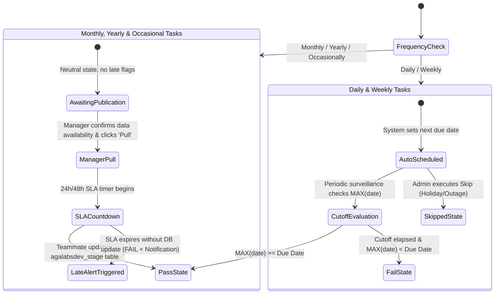
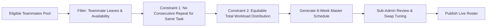

# Crishi Database Module Specification

> **Document Version:** 2.0  
> **Status:** Detailed Engineering Blueprint  
> **Module:** Crishi Database (Live Database Surveillance, Governance & Roster Engine)

---

## 1. Module Overview

The **Crishi Database** module is the central nervous system of the redesigned Advanced MIS. It replaces manual task self-reporting with **live, automated database surveillance**. By querying table timestamps directly from the operational MySQL database (`agalabsdev_stage`), the system guarantees that task statuses reflect true database operations.

Furthermore, this module incorporates:
1. A **Variable Frequency Governance Engine** distinguishing between automatic cadences (Daily, Weekly) and manager-confirmed cadences (Monthly, Yearly, Occasionally).
2. A **2-Month Fair Roster Generator** featuring Sub-Admin delegation and rotating logistics tasks such as **Rake Movement**.

---

## 2. The 10-Column Data Representation Grid

The primary view in the Crishi Database module is a high-density, real-time data grid designed for commodity market research teams:

```
┌────────────────────────────────────────────────────────────────────────────────────────────────────────────────────────────────────────────────────────┐
│ CRISHI DATABASE — LIVE SURVEILLANCE & TASK GOVERNANCE                                                   [Filter by Commodity ▼] [Filter by User ▼]   │
├─────────┬──────────────┬─────────────────────────────┬───────────────────────────┬───────────┬──────────────┬──────────────┬──────────┬────────┬───────────┤
│ User    │ Commodity    │ Raw Table Name              │ Final Name                │ Frequency │ Last Updated │ Due Date     │ Status   │ Remark │ Source    │
├─────────┼──────────────┼─────────────────────────────┼───────────────────────────┼───────────┼──────────────┼──────────────┼──────────┼────────┼───────────┤
│ Nishant │ Bengal Gram  │ ipga_imported_market_prices │ Imported Market Prices    │ Daily     │ 2026-10-14   │ 2026-10-14   │ PASS 🟢  │ [Edit] │ IPGA (⚙)  │
│ Nishant │ Tur (Arhar)  │ ipga_cnf                    │ Pulses CNF Rates          │ Daily     │ 2026-10-14   │ 2026-10-14   │ PASS 🟢  │ [Edit] │ IPGA (⚙)  │
│ Nitesh  │ Maize        │ pyexcel_rakemovement        │ Daily Rake Movement       │ Daily     │ 2026-10-13   │ 2026-10-14   │ FAIL 🔴  │ [Add]  │ FOIS (⚙)  │
│ Nitesh  │ Poultry/Egg  │ pyexcel_egg_prices          │ NECC Egg Prices           │ Daily     │ 2026-10-14   │ 2026-10-14   │ PASS 🟢  │ [Edit] │ NECC (⚙)  │
│ Nishant │ Pulses       │ pystage_factrates_sowing... │ Weekly Sowing Progress    │ Weekly    │ 2026-10-12   │ 2026-10-14   │ SKIP 🟡  │ Holiday│ MoA (⚙)   │
│ Nitesh  │ Maize        │ pyexcel_central_pool_stock  │ Central Pool Stock        │ Monthly   │ 2026-09-21   │ 2026-10-15   │ PULL 🔵  │ Ready  │ FCI (⚙)   │
│ Nishant │ Pulses       │ pyexcel_msp                 │ Pulses MSP Rates          │ Yearly    │ 2026-10-19   │ Awaiting     │ IDLE ⚪  │ [Add]  │ CACP (⚙)  │
└─────────┴──────────────┴─────────────────────────────┴───────────────────────────┴───────────┴──────────────┴──────────────┴──────────┴────────┴───────────┘
```

### 2.1 Column Definitions & Visual Rules

| Column # | Field Name | Data Source | Behavior & Formatting |
| :---: | :--- | :--- | :--- |
| **1** | **User** | Assigned Teammate | Researcher assigned primary ownership (e.g., Nishant, Nitesh, Deep, Manish, Priyanshi, Poorvi). |
| **2** | **Commodity** | Category Metadata | Agricultural commodity group (e.g., Bengal Gram, Tur, Urad, Maize, Soybeans, Sugar, Weather, Logistics). |
| **3** | **Raw Table Name** | Physical MySQL Table | Exact table identifier in `agalabsdev_stage` (e.g., `pyexcel_rakemovement`, `ipga_arrivals_marketwise`). Clicking copies table name to clipboard. |
| **4** | **Final Name** | Business Display Name | Clean human-readable title (e.g., "Daily Rake Movement", "USDA Balancesheet World"). |
| **5** | **Frequency** | Cadence Rule | Tagged badge: `Daily`, `Weekly`, `Monthly`, `Yearly`, `Occasionally`. |
| **6** | **Last Updated Date** | Live DB Query | Result of `MAX(date_column)` from the raw table. Formatted as `YYYY-MM-DD` or `YYYY-MM-DD HH:mm`. |
| **7** | **When It Should Be Updated** | Schedule Engine | Calculated target due date/time based on frequency rules, calendar business days, or Manager Pull timestamp. |
| **8** | **Status** | Dynamic Evaluation | **Visual Badges:**<br>• **PASS (Green):** `last_updated >= due_date`<br>• **FAIL (Red):** `last_updated < due_date` and cutoff elapsed<br>• **SKIPPED (Amber):** Manager approved administrative skip<br>• **AWAITING PULL (Gray/Blue):** Monthly/Yearly task not yet confirmed by manager |
| **9** | **Remark** | User / Admin Note | Popover/Modal allowing users or managers to input context (e.g., "Government release delayed to Thursday; will update tomorrow morning"). |
| **10** | **Source** | Origin URL / Portal | Primary source origin (e.g., `Agmarknet`, `IPGA Portal`, `NECC`, `USDA`, `FOIS`). Set once, editable via pencil icon by managers or assignees. |

---

## 3. Frequency Governance Engine

The redesigned system establishes clear, automated boundaries depending on whether task availability is routine or sporadic:



### 3.1 Daily & Weekly Tasks (Zero-Admin Automation)
- **Automatic Scheduling:** The system creates and evaluates recurring deadlines automatically without requiring manager intervention.
- **Cutoff Times:**
  - **Daily Tasks:** Cutoff is 18:30 IST on every working day (Monday – Saturday).
  - **Weekly Tasks:** Cutoff is determined by the specific cadence day (e.g., Tuesday 18:30 IST for Sowing Progress; Friday 19:00 IST for Weekly Arrivals).
- **Admin "Skip" Workflow:**
  - If a daily or weekly source is unavailable due to an external factor (e.g., Mandi closed for festival, government server under maintenance), the Manager clicks **"Skip Task"**.
  - A modal captures the mandatory reason:
    ```json
    {
      "task_id": 104,
      "date": "2026-10-14",
      "action": "SKIP",
      "reason": "Agmarknet APMC mandi holiday on account of local elections",
      "authorized_by": "nishant@admin.com"
    }
    ```
  - The status displays **"Skipped (Pass - Amber)"** and suppresses the late update failure.

---

### 3.2 Monthly, Yearly & Occasional Tasks (Manager "Pull" Workflow)
Because publications like USDA WASDE, Directorate of Economics & Statistics Advance Estimates, and OMSS tenders publish on erratic schedules, **they must never trigger false-positive late alerts**.

1. **Default Neutral State:** Remains labeled as **"Awaiting Source Publication"**. No late penalty is incurred.
2. **The Manager "Pull" Action:**
   - When the Manager or Leader verifies that the external report or data file has been published by the agency, they click the **"Pull Task"** button on the row.
   - The system records:
     - `pulled_at`: Current timestamp.
     - `pulled_by`: Manager user ID.
     - `target_deadline`: Current time + SLA (configurable, default: 24 business hours).
3. **Automated Surveillance & SLA Countdown:**
   - The MIS daemon monitors the designated raw table in `agalabsdev_stage`.
   - If a new row with date >= `pulled_at` date is detected, the task transitions immediately to **Pass (Green)**.
4. **Late Update Alert Trigger:**
   - If the SLA countdown reaches 00:00:00 and no matching record exists in `agalabsdev_stage`:
     1. Status turns to **Fail (Red)**.
     2. A high-priority **"Late Update Alert"** is broadcast to the MIS header notifications.
     3. An escalation audit entry is written: `"Teammate failed to update table after manager data availability confirmation"`.

---

## 4. Weekly Roster Engine & 2-Month Rotation

The Weekly Roster manages rotating operational responsibilities among research teammates.

### 4.1 Sub-Admin Role Delegation
- **The Problem:** In the legacy system, only full administrators could edit rosters, causing administrative bottlenecks.
- **The Redesign Solution:** Managers can assign a specialized **"Sub-Admin (Roster Only)"** permission to any teammate.
- **Capabilities of Sub-Admin:**
  - Access the Roster Management view with full editing, generating, and swapping permissions.
  - Generate the 2-month schedule.
  - Approve mutual duty swaps between teammates.
  - *Boundary:* A Sub-Admin cannot execute Manager Pulls, modify table source URLs, or alter user system roles.

---

### 4.2 Inclusion of the "Rake Movement" Logistics Duty
Railway rake movements (`pyexcel_rakemovement` and `pyexcel_maize_matured_rake`) represent vital logistics data showing agricultural commodity freight flows across India:
- In the redesigned system, **Rake Movement** is formally registered as a core rotational duty alongside Market Arrivals, Port Lineups, and News Aggregation.
- The assignee on Rake Movement duty for the week is responsible for ensuring the 28,000+ row dataset in `pyexcel_rakemovement` is verified and ingested accurately.

---

### 4.3 Two-Month Unique Non-Repeating Rotation Algorithm

The generator produces a 8 to 9 week forward-looking roster schedule adhering to mathematical fairness constraints:



#### Mathematical Formulation & Rules:
Let $T = \{t_1, t_2, \dots, t_k\}$ be the set of rotating weekly duties (e.g., Rake Movement, Market Arrivals, Port Lineup, Weather Maps).  
Let $U = \{u_1, u_2, \dots, u_n\}$ be the pool of active research teammates.  
Let $W = \{w_1, w_2, \dots, w_8\}$ be the 8 consecutive weeks of the next 2 months.

1. **Strict Non-Consecutive Constraint:**  
   $$\forall u \in U, \forall t \in T, \text{if } Assignment(w_i, t) = u \implies Assignment(w_{i+1}, t) \neq u$$
   *(No person shall perform the same duty two weeks in a row).*
2. **Pairing Diversity Constraint:**  
   The duty assigned to teammate $u$ in week $w_{i+1}$ must differ from their duty in week $w_i$, rotating them across different operational functions.
3. **Balanced Load Constraint:**  
   $$\max_{u \in U}(\text{Assignments}(u)) - \min_{u \in U}(\text{Assignments}(u)) \le 1$$
   *(Workload across the 8-week horizon is distributed with equal frequency).*
4. **Rake Movement Specialist Backup:**  
   Because Rake Movement requires data cleaning expertise, the algorithm ensures that the selected assignee either has prior experience or is paired with an automated validation checklist.

---

## 5. Live Database Query Engine (`agalabsdev_stage`)

To ensure real-time accuracy without overloading the MySQL server, the surveillance engine utilizes optimized metadata queries:

```python
# Surveillance Query Architecture
def get_table_latest_date(connection, table_name, date_column):
    query = f"""
        SELECT MAX(`{date_column}`) AS latest_val 
        FROM `agalabsdev_stage`.`{table_name}`
        WHERE `{date_column}` IS NOT NULL 
          AND `{date_column}` != '0000-00-00' 
          AND `{date_column}` != '0000-00-00 00:00:00';
    """
    with connection.cursor() as cursor:
        cursor.execute(query)
        result = cursor.fetchone()
        return result['latest_val'] if result else None
```

### Intelligent Caching & Manual Trigger
- The daemon polls the database on a configured interval (e.g., every 5 minutes during trading hours 09:00 – 19:00 IST).
- Results are cached in Redis / In-Memory cache for instantaneous grid rendering.
- A **"Refresh Now" (🔄)** button on the UI allows users or managers to bypass cache and force an immediate re-query of all active tables.
