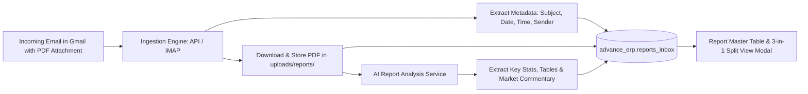

# Report Module & Gmail Ingestion Architecture

> **Document Version:** 2.0  
> **Status:** Detailed Engineering Blueprint  
> **Scope:** Automated Email Ingestion, Report Data Storage, and 3-in-1 Inspection Modal (Email + PDF + AI Analysis)

---

## 1. Overview & Business Workflow

In the legacy MIS, users were required to manually upload daily PDF reports (such as *Maize Daily Digest*, *Pulses Daily*, or *Maize Daily Wire*) through an upload form.

In the redesigned MIS:
> **All report data is ingested automatically from incoming emails in your Gmail inbox.**  
> Users do not upload files manually. When market reports arrive via email, the system automatically parses the email metadata, downloads the attached PDF report, triggers an AI analysis pipeline, and lists it in the **Report** module.



---

## 2. How the System Pulls Report Data from Gmail

To answer the user's specific question:  
> *"report will pull from the automatic report data which is get from mail which i get in my Gmail let me know how i will get the data"*

There are **three robust methods** to connect the MIS to your Gmail inbox. Below is a detailed technical comparison, followed by the recommended setup steps:

### 2.1 Comparison of Gmail Ingestion Methods

| Feature | Method 1: Python IMAP + App Password *(Recommended for Fast Deployment)* | Method 2: Google Gmail REST API *(Recommended for Enterprise)* | Method 3: Google Apps Script Webhook |
| :--- | :--- | :--- | :--- |
| **Setup Complexity** | **Very Low** (Takes 3 minutes) | Medium (Requires Google Cloud Console project) | Low |
| **GCP Project Needed?** | ❌ No | ✅ Yes (OAuth2 / Service Account) | ❌ No |
| **Protocol** | IMAP over SSL (`imap.gmail.com:993`) | HTTPS REST API (`gmail.googleapis.com`) | HTTP POST Webhook |
| **Security** | 16-character Gmail "App Password" | OAuth2 Token / Service Account Key | Script execution token |
| **Attachment Handling** | Direct binary stream via Python standard `email` | Base64 decoded via REST API | Base64 POST payload |
| **Trigger Mechanism** | Scheduled Cron Polling (e.g., every 3 mins) | Push Notifications (Pub/Sub) or Polling | Gmail Filter Trigger on arrival |

---

### 2.2 Method 1 (Recommended): Python IMAP Ingestion Engine

This is the fastest, most reliable method because it uses Python's built-in `imaplib` and `email` packages with no external Google Cloud project required.

#### Step 1: Generate a Gmail App Password
1. In your Google Account, enable **2-Step Verification** (if not already enabled).
2. Go to [Google App Passwords](https://myaccount.google.com/apppasswords).
3. Under **App Name**, enter `Advance MIS Report Collector` and click **Create**.
4. Google will give you a 16-letter password (e.g., `abcd efgh ijkl mnop`).
5. Add these credentials to your `.env` file:
   ```env
   GMAIL_IMAP_SERVER=imap.gmail.com
   GMAIL_IMAP_PORT=993
   GMAIL_USER=your_email@gmail.com
   GMAIL_APP_PASSWORD=abcdefghijklmnop
   GMAIL_SEARCH_CRITERIA=SUBJECT "Daily" OR SUBJECT "Digest" OR SUBJECT "Wire"
   ```

#### Step 2: The Ingestion Daemon Code (`app/services/email_ingestion.py`)
```python
import imaplib
import email
from email.header import decode_header
import os
from datetime import datetime
from app import db
from app.models import EmailReport

def clean_header(val):
    if not val:
        return ""
    decoded, enc = decode_header(val)[0]
    if isinstance(decoded, bytes):
        return decoded.decode(enc or "utf-8", errors="ignore")
    return str(decoded)

def fetch_gmail_reports():
    server = os.getenv("GMAIL_IMAP_SERVER", "imap.gmail.com")
    username = os.getenv("GMAIL_USER")
    password = os.getenv("GMAIL_APP_PASSWORD")
    
    mail = imaplib.IMAP4_SSL(server)
    mail.login(username, password)
    mail.select("INBOX")
    
    # Search for unread emails with attachments or matching subject lines
    status, messages = mail.search(None, '(UNSEEN SUBJECT "Daily")')
    if status != "OK":
        return []
    
    processed_reports = []
    
    for num in messages[0].split():
        status, data = mail.fetch(num, "(RFC822)")
        raw_email = data[0][1]
        msg = email.message_from_bytes(raw_email)
        
        subject = clean_header(msg.get("Subject"))
        sender = clean_header(msg.get("From"))
        date_tuple = email.utils.parsedate_tz(msg.get("Date"))
        sent_datetime = datetime.fromtimestamp(email.utils.mktime_tz(date_tuple)) if date_tuple else datetime.utcnow()
        
        # Extract body
        body_html = ""
        body_text = ""
        saved_pdf_path = None
        report_name = subject
        
        for part in msg.walk():
            content_type = part.get_content_type()
            disposition = str(part.get("Content-Disposition"))
            
            if content_type == "text/plain" and "attachment" not in disposition:
                body_text = part.get_payload(decode=True).decode(errors="ignore")
            elif content_type == "text/html" and "attachment" not in disposition:
                body_html = part.get_payload(decode=True).decode(errors="ignore")
            
            # Extract PDF Attachment
            if "attachment" in disposition or part.get_filename():
                filename = clean_header(part.get_filename())
                if filename.lower().endswith(".pdf"):
                    # Auto-detect report name from file
                    report_name = filename.replace(".pdf", "")
                    target_dir = os.path.join("uploads", "reports", sent_datetime.strftime("%Y-%m"))
                    os.makedirs(target_dir, exist_ok=True)
                    file_path = os.path.join(target_dir, filename)
                    
                    with open(file_path, "wb") as f:
                        f.write(part.get_payload(decode=True))
                    saved_pdf_path = file_path
        
        # Store in ERP Database
        if saved_pdf_path:
            report_entry = EmailReport(
                report_name=report_name,
                subject=subject,
                sender=sender,
                date_sent=sent_datetime.date(),
                time_sent=sent_datetime.time(),
                file_path=saved_pdf_path,
                email_body_html=body_html or body_text,
                status="Analyzed"
            )
            db.session.add(report_entry)
            db.session.commit()
            
            # Trigger Asynchronous AI Analysis
            trigger_ai_report_analysis(report_entry.id)
            processed_reports.append(report_entry.id)
            
        # Mark as read/flagged so it is not processed twice
        mail.store(num, "+FLAGS", "\\Seen")
        
    mail.close()
    mail.logout()
    return processed_reports
```

---

## 3. Report Master Table Formatting

In the Report module UI, reports are presented in an executive table:

```
┌────────────────────────────────────────────────────────────────────────────────────────────────────────────────────────┐
│ AUTOMATED MARKET REPORTS (INGESTED FROM GMAIL)                                           [Search...] [Select Date ▼]   │
├──────────────────────────────────────┬────────────┬──────────────────────────────────────┬───────────┬─────────────────┤
│ Report Name                          │ Date       │ Subject                              │ Time Sent │ Status          │
├──────────────────────────────────────┼────────────┼──────────────────────────────────────┼───────────┼─────────────────┤
│ Maize Daily Digest_Report_2026_05_13 │ 2026-05-13 │ Daily Digest: Maize Market Analysis  │ 09:15 AM  │ Analyzed 🟢     │
│ Maize Daily Wire_2026_05_13          │ 2026-05-13 │ Maize Daily Wire - Price Alert       │ 10:30 AM  │ Analyzed 🟢     │
│ Pulses Daily_12_05_26                │ 2026-05-12 │ IPGA Pulses Daily Update - 12 May    │ 08:45 AM  │ Analyzed 🟢     │
│ Maize Weekly Digest_Report_2026_05_11│ 2026-05-11 │ Weekly Digest: Maize & Feed Grains   │ 11:00 AM  │ Analyzed 🟢     │
│ Pulses Weekly_11_05_26               │ 2026-05-11 │ Comprehensive Pulses Weekly Report   │ 11:30 AM  │ Analyzed 🟢     │
└──────────────────────────────────────┴────────────┴──────────────────────────────────────┴───────────┴─────────────────┘
```

### Table Columns:
1. **Report Name:** Standardized commodity report title extracted from the PDF or subject line. Clicking this row opens the **3-in-1 Detail Inspection View**.
2. **Date:** Transmission date formatted as `YYYY-MM-DD`.
3. **Subject:** Exact original subject line from Gmail.
4. **Time Sent:** Exact timestamp of email dispatch (e.g., `09:15 AM IST`).
5. **Status:** Processing indicator (`Ingested`, `Analyzed`, or `Verification Warning`).

---

## 4. The 3-in-1 Report Inspection Modal / Split View

When a user clicks on any report row, a fullscreen or split-screen modal opens containing **three synchronized panels**:

```
┌────────────────────────────────────────────────────────────────────────────────────────────────────────────────────────┐
│ REPORT INSPECTION: Maize Daily Digest — 2026-05-13                                                            [✕ Close]│
├───────────────────────────────┬───────────────────────────────────────────────┬────────────────────────────────────────┤
│ 📨 PANEL 1: EMAIL PREVIEW     │ 📄 PANEL 2: PDF PREVIEW                       │ 🧠 PANEL 3: AI REPORT ANALYSIS        │
├───────────────────────────────┼───────────────────────────────────────────────┼────────────────────────────────────────┤
│ From: research@agalabs.com    │ ┌───────────────────────────────────────────┐ │ 📊 Executive Summary:                  │
│ Date: 13 May 2026 09:15 AM    │ │ [PDF Viewer Toolbar: Zoom / Page / Print] │ │ • Domestic maize arrivals steady at   │
│ Subject: Daily Maize Digest   │ ├───────────────────────────────────────────┤ │   12,450 MT across key Bihar mandis.   │
│ Attachments: digest_13_05.pdf │ │ MAIZE DAILY DIGEST                        │ │ • Chhindwara spot rates up +1.2%.      │
│                               │ │ Issue: 13 May 2026                        │ │                                      │
│ Dear Team,                    │ │                                           │ │ 🔍 Required Sections Audit:           │
│ Please find attached the      │ │ 1. Executive Summary                      │ │ • Spot Price Table: PRESENT 🟢       │
│ Maize Daily Digest for today. │ │ 2. Mandi Arrivals                         │ │ • Feed Parity Chart: PRESENT 🟢      │
│ Key highlights include spot   │ │ 3. Feed & Starch Prices                   │ │ • International Parity: PRESENT 🟢   │
│ price hardening across Nizam- │ │ [Interactive Embedded Canvas]             │ │                                      │
│ abad and Davangere.           │ │                                           │ │ ⚠️ Anomaly Detection:                 │
│                               │ │                                           │ │ • Yellow Corn FOB price spiked 4.5%  │
│ Regards, Research Desk        │ │                                           │ │   vs 7-day average.                  │
└───────────────────────────────┴───────────────────────────────────────────────┴────────────────────────────────────────┘
```

### Detailed Breakdown of the Three Panels:

### Panel 1: Email Preview
- **Header Metadata:** Displays Sender name and email address, recipient list, original subject line, and formatted timestamp.
- **Rendered Content:** Sanitized HTML body (or plain-text fallback) preserving styling, signatures, and inline links.
- **Attachment Badge:** Direct download link for the original raw attachment.

### Panel 2: Interactive PDF Viewer
- Uses modern PDF embedding (`<iframe src="/api/reports/{id}/pdf" type="application/pdf">` or `PDF.js`).
- Features page navigation, zoom controls, fit-to-width, search within PDF text, and full-screen toggle.
- Enables analysts to scrutinize every chart, table, and data footnote side-by-side with the email and AI findings.

### Panel 3: AI Report Analysis
The AI engine automatically analyzes the PDF content upon ingestion using an LLM / OCR parsing pipeline:
1. **Executive Key Points:** Concise 3-5 bullet point synopsis of vital price shifts, supply changes, and government procurement trends.
2. **Template Completeness Verification:** Checks whether all expected sections (Executive Summary, Spot Table, CME Futures, Parity Comparison) are physically present in the PDF.
3. **Statistical Extraction:** Automatically extracts key benchmark prices (e.g., Agmarknet spot rate, CBOT corn futures, CNF landed port price) into structured JSON.
4. **Market Anomalies:** Automatically highlights outliers (e.g., daily price change > 3% or arrival drop > 20% compared to historical baselines).
