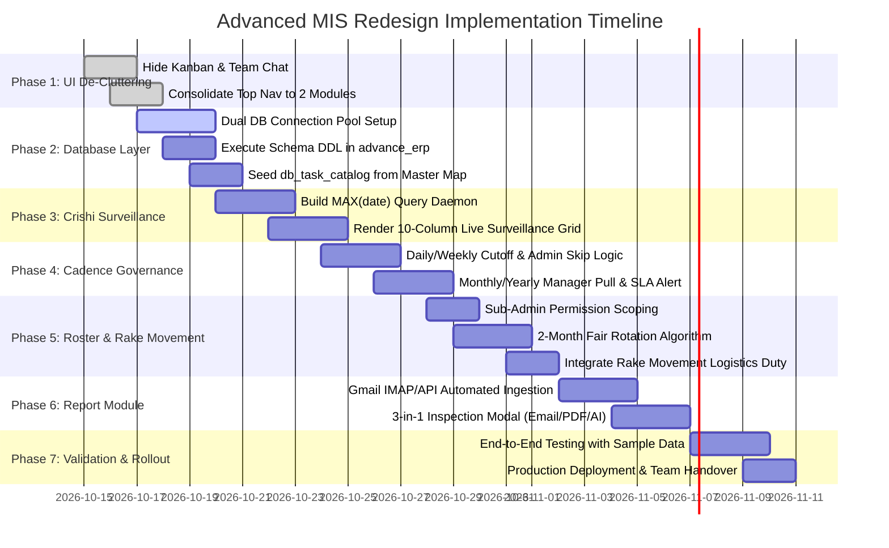

# Implementation Roadmap & Migration Strategy

> **Document Version:** 2.0  
> **Status:** Execution Blueprint  
> **Target Timeline:** Phased Iterative Rollout

---

## 1. Migration Strategy & Zero-Downtime Philosophy

The redesign of the Advanced MIS converts an active operational portal into an automated surveillance platform without disrupting current market research output.

### Guiding Principles:
1. **Parallel Verification:** During the transition, the database surveillance daemon will run in parallel with legacy checks to validate data consistency against the 132 tables in `latest_two_dates_agalabsdev_stage`.
2. **Clean UI De-Cluttering:** Immediately remove the Kanban Board and Team Chat links to focus analyst attention on **Crishi Database** and **Report**.
3. **Decoupled Architecture:** Dual-database connections (`agalabsdev_stage` for raw tables; `advance_erp` for metadata) ensure raw research tables cannot be corrupted by web app operations.

---

## 2. Seven-Phase Implementation Plan



---

## 3. Phase-by-Phase Deliverables & Technical Checklists

### Phase 1: Navigation Streamlining & UI Consolidation
- **Objectives:** Clean up top bar, sidebar, and dashboard routing.
- **Tasks:**
  - Update `app/templates/base.html`: Remove "Kanban Board" and "Team Chat" nav links.
  - Establish the 2 primary navigation items:
    1. **Crishi Database** (`/crishi-database`)
    2. **Report** (`/reports`)
  - Redirect default `/` home route to `/crishi-database`.
  - Disable legacy routes in `app/routes/kanban.py` and `app/routes/chat.py`.

### Phase 2: Dual Database Setup & Catalog Seeding
- **Objectives:** Configure secure connections to `agalabsdev_stage` and seed the table catalog.
- **Tasks:**
  - Update `app/config.py` with multi-bind SQLAlchemy URIs:
    ```python
    SQLALCHEMY_DATABASE_URI = os.getenv("MYSQL_URI") # advance_erp
    SQLALCHEMY_BINDS = {
        'stage_db': os.getenv("STAGE_DB_URI")        # agalabsdev_stage
    }
    ```
  - Execute database DDL (`db_task_catalog`, `manager_task_pulls`, `task_skips`, `task_remarks`, `roster_schedules`, `email_reports`).
  - Run database seed script importing all tables and assignees from `05_TASK_TO_DATABASE_MAPPING_MATRIX.md`.

### Phase 3: Crishi Database Live Surveillance Grid
- **Objectives:** Deploy the real-time 10-column monitoring view.
- **Tasks:**
  - Implement `app/services/surveillance.py` to query `MAX(date_col)` across all catalog tables.
  - Build responsive frontend data table in `app/templates/crishi_db.html` with columns:
    `User | Commodity | Raw Table Name | Final Name | Frequency | Last Updated Date | When it should be updated | Status | Remark | Source`.
  - Implement Pass (Green) / Fail (Red) status pills with instant filtering.
  - Implement editable popover for User Remarks and Source URLs.

### Phase 4: Cadence Governance, Admin Skip & Manager Pull
- **Objectives:** Prevent false-positive alerts on irregular publications and support emergency skips.
- **Tasks:**
  - Configure automated cutoffs for Daily (18:30 IST) and Weekly tasks.
  - Add **"Admin Skip"** button & modal for managers with mandatory reason capture.
  - Build the **"Manager Pull"** workflow for Monthly, Yearly, and Occasional tasks:
    - Button: "Confirm Data Available / Pull Task".
    - SLA Countdown timer (24h default).
    - If deadline expires without DB update, trigger the **Late Update Alert** banner.

### Phase 5: Weekly Roster Engine with Rake Movement & Sub-Admin
- **Objectives:** Automate an 8-week fair duty schedule.
- **Tasks:**
  - Add `is_roster_sub_admin` flag to `User` model and user management screen.
  - Formally register `pyexcel_rakemovement` (Rake Movement duty) in the roster rotation.
  - Implement the 2-Month Non-Repeating Rotation Algorithm in `app/services/roster_generator.py`.
  - Build week-by-week interactive calendar view with duty swap controls.

### Phase 6: Report Module & Automated Gmail Ingestion
- **Objectives:** Ingest market PDFs from Gmail and provide 3-in-1 inspection.
- **Tasks:**
  - Implement `app/services/email_ingestion.py` using IMAP SSL with Gmail App Password.
  - Background scheduler checks inbox every 3 minutes, saves PDFs to `uploads/reports/`, and records metadata.
  - Build the Report master table: `Report Name | Date | Subject | Time Sent | Status`.
  - Build the **3-in-1 Inspection Modal**:
    - Left Panel: Sanitized Email preview.
    - Center Panel: Interactive PDF viewer canvas.
    - Right Panel: AI summary, section checklist, and market anomalies.

### Phase 7: Quality Assurance, Validation & Deployment
- **Objectives:** Verify against real 132-table snapshot and train users.
- **Tasks:**
  - Run regression test suite comparing `latest_two_dates_agalabsdev_stage` timestamps with computed grid statuses.
  - Test Gmail ingestion with sample PDFs (`Maize Daily Digest_Report_2026_05_08.pdf`, `Pulses Daily_11_05_26.pdf`).
  - Deploy to production server and conduct walkthrough with managers and analysts.

---

## 4. Operational Risk Management & Mitigation

| Risk Scenario | Likelihood | Impact | Preventive Mitigation |
| :--- | :---: | :---: | :--- |
| **MySQL Server Overload from Constant Surveillance** | Low | High | Results of `MAX(date)` queries are cached with 5-minute TTL; queries use indexed date columns. |
| **Gmail Disconnection / Password Revocation** | Medium | Medium | Automated health check notifies admin via MIS toast if IMAP authentication fails consecutively. |
| **Source Portal Down for Days** | High | Low | Manager uses Admin Skip override with documented reason, preventing false red fail marks. |
| **Teammate on Sudden Emergency Leave** | High | Medium | Sub-Admin or Manager executes instant 1-click duty swap in the Roster Engine. |
| **Duplicate Email Ingestion** | Medium | Low | SHA-256 hash check on incoming email Message-ID and PDF binary prevents duplicate records. |
